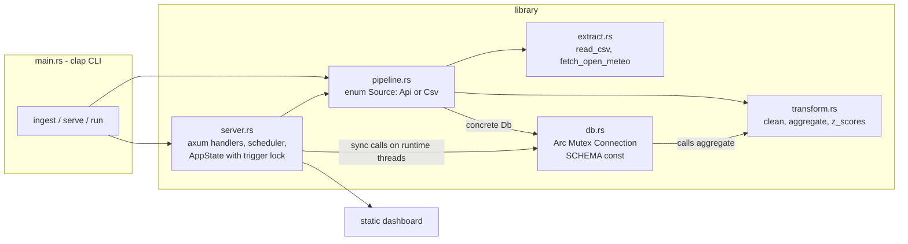
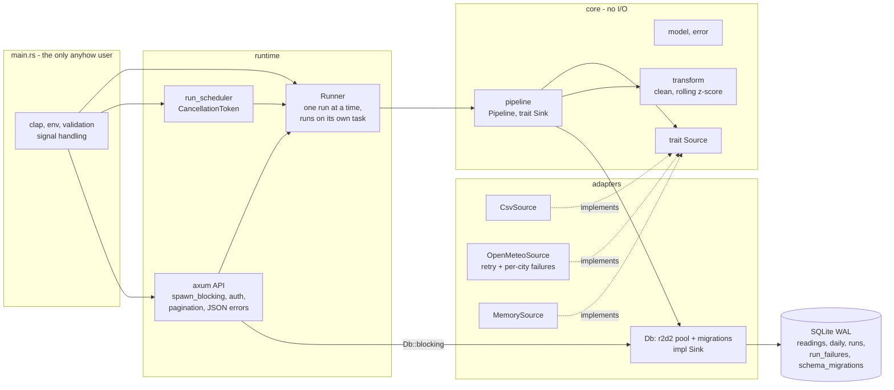

# PulseETL architecture review (v1.0.0 -> v1.1.0)

Scope: the whole v1.0.0 codebase (about 1,500 lines of Rust plus the static dashboard). Portfolio scale, so
the bar is "correct, testable, honest about its limits", not "distributed". No Kafka, no Airflow.

## 1. Architecture as reviewed (v1.0.0)

What was already good: stages are separate modules, pure transform logic with solid unit tests, idempotent
upserts in one transaction, a `runs` ledger, retry with backoff, overlap protection with `try_lock`, 17 passing
tests and clean clippy.

What was not: everything below.

## 2. Findings

Severity: **High** = wrong results or blocks the service under normal use; **Medium** = fails in realistic
operation or blocks evolution; **Low** = polish or acceptable at this scale.

| ID | Sev | Issue | Why it matters | Fix | Status |
| --- | --- | --- | --- | --- | --- |
| F1 | High | Synchronous rusqlite behind a `std::sync::Mutex` is called directly from async axum handlers and from the async pipeline. | A long `load` (full rebuild of the daily tables) holds the mutex and parks a tokio worker thread; every other request that touches the DB then blocks a worker too. With few cores the whole server stalls, including `/api/health`. | r2d2 connection pool (WAL, so readers run during a write) and all DB work through `Db::blocking` / `spawn_blocking`. `Sink` impl does this internally. Test proves a single-threaded runtime keeps ticking during 300 ms of DB work. | Fixed |
| F2 | High | Anomaly z-score is computed over the whole stored series, mean and std-dev of everything including the point being tested. Series under 3 days never flag. | One spike inflates the std-dev and hides itself and its neighbours; a seasonal trend makes the ends of the series look anomalous; results for old days change when new data arrives. It is not "rolling" despite the dashboard calling it a 7-day view. | Trailing-window detector: each day is scored against the previous N calendar days (default 7, `--anomaly-window`), excluding itself and gross outliers, needing at least `--min-baseline` days (default 3). Per-metric noise floor on the spread so calm weeks do not turn wiggles into z=40. 6 new unit tests. | Fixed |
| F3 | High | Partial per-city API failures are only `tracing::error!`-ed; the run still says `success`. | A run that silently lost Tokyo looks identical to a perfect one. Operators and the dashboard cannot see data gaps. | `Source::extract` returns `Extraction { rows, failures }`. Failures are stored in a new `run_failures` table, returned on `RunRecord.failures`, summarised in `message`, and downgrade the status to `partial`. Tested against a mock Open-Meteo that 500s for one city. | Fixed |
| F4 | Medium | Pipeline hard-wired to the concrete `Db` and an `enum Source`; `ingest_rows` was a second code path only for tests. | Cannot add a source or sink, or test the orchestration without SQLite and the filesystem. Two paths drift. | `Source` (extract) and `Sink` (start_run / load / finish_run) traits, `Pipeline` owns `Arc<dyn Source>` and `Arc<dyn Sink>`. `CsvSource`, `OpenMeteoSource`, `MemorySource`; `Db` implements `Sink`. Orchestration tested with a fake sink. `transform` stays a pure function on purpose. | Fixed |
| F5 | Medium | `POST /api/ingest` is unauthenticated. | Anyone who can reach the port can trigger runs that hit the upstream API and rewrite aggregates. Default bind is loopback, but `--addr 0.0.0.0` is one flag away. | Optional bearer token (`PULSE_API_TOKEN` / `--api-token`), constant-time comparison, `401` + `WWW-Authenticate`; `/api/health` reports `ingest_protected`; startup warns when bound to a non-loopback address without a token. Dashboard prompts once and keeps the token in `sessionStorage`. | Fixed |
| F6 | Medium | Schema is a `CREATE TABLE IF NOT EXISTS` blob run on every open; no version table; no way to evolve safely; no index for the `(city, metric)` scans done on every load. | The first schema change would need hand-written upgrade code or break existing files. A newer database opened by an older binary would be silently used. | Ordered, append-only migrations, each in its own immediate transaction, recorded in `schema_migrations`. v1 adopts v1.0.0 databases unchanged. v2 adds `run_failures` and a covering index `(city, metric, ts, value)`. Opening a database from a newer build is refused. | Fixed |
| F7 | Medium | An ingest started from the API runs inside the request future. If the client disconnects, the future is dropped mid-run. A process crash leaves the row in `running` forever. | Phantom "running" runs in the history; a cancelled run may have extracted but never recorded its outcome. | `Runner::trigger` runs the pipeline on its own task that owns the overlap lock, so callers can go away without abandoning the run. `Db::fail_stale_runs` closes rows left `running` by a dead process at server start. | Fixed |
| F8 | Medium | Scheduler loop never ends; shutdown only handles Ctrl-C for the HTTP server and the scheduler task is just dropped. | A run in flight is killed at exit; no SIGTERM handling on unix (containers, systemd). | One `CancellationToken` driven by Ctrl-C / SIGTERM: server drains gracefully, the scheduler stops starting new runs and lets the current one finish (30 s grace). If the server dies, the scheduler is stopped too. | Fixed |
| F9 | Medium | `/api/series` returns everything with no paging; query errors (`limit=abc`) come back as axum's plain text; unknown routes return an empty 404; `runs` silently clamps. | Unbounded responses; clients must handle two error shapes. | `from`, `to`, `limit` (default 366, max 1000), `offset`, plus `total` in the response. Custom `ApiQuery` extractor and JSON fallback so every error is `{"error", "code"}`. Inputs validated (dates, city length, from <= to). | Fixed |
| F10 | Medium | `anyhow` used throughout the library; run status is a free string; `finish_run` takes six positional arguments. | Callers cannot match on failure kinds; typos in status strings compile; easy to swap two `usize`s. | `thiserror` types `StoreError` and `ExtractError`; `RunStatus` enum; `RunOutcome` struct. `anyhow` only in `main.rs`. | Fixed |
| F11 | Medium | Config: only some options readable from env; no validation (`--z-threshold -1`, `--past-days 0`, interval 0 was silently bumped). | Bad values give confusing behaviour at runtime rather than an error at startup. | Every option has a `PULSE_*` env var; ranges enforced by clap (`past_days` 1..=92, window 2..=90, positive threshold, interval >= 1). | Fixed |
| F12 | Low | `2u32.pow(n)` in `retry` overflows (panic in debug, wrap in release) when `attempts` > 32. | Panic on a runtime path with a hostile config. | Saturating arithmetic and a 60 s cap. | Fixed |
| F13 | Low | `overview()` turns any error fetching the last run into "no last run" (`.ok()`). | Hides database errors. | `optional()` and propagate. | Fixed |
| F14 | Low | Every load re-reads all readings of each touched series and rebuilds its daily rows. | O(history) per run. Fine for thousands of rows; would hurt at millions. | Left. The new covering index makes it a range scan. Revisit with incremental aggregation if data grows. | Left |
| F15 | Low | Open-Meteo cities are a constant list and are fetched sequentially. | Adding cities means a code change; latency is the sum. | Left. `OpenMeteoSource::with_cities` makes it configurable in code; a config file is more machinery than this project needs. | Left |
| F16 | Low | Read endpoints are public; no rate limiting, no TLS. | Fine for a local dashboard. | Left on purpose. Put a reverse proxy in front if exposed; only the mutating endpoint is protected. | Left |
| F17 | Low | The dashboard issues one `/api/series` request per city. | N+1 requests. | Left; five small cached-by-SQLite queries, not worth a new aggregate endpoint. | Left |
| F18 | Low | No SIGTERM on Windows (Ctrl-C only); runs interrupted by a hard kill are only reaped at next start. | Platform limitation. | Left; documented. | Left |
| F19 | Low | Upgrading keeps old z-scores in `daily` until the next ingest recomputes the touched series. | Briefly stale flags after upgrade. | Left; noted in the changelog (run one ingest). | Left |

Dependency direction after the repair: `model` and `error` at the centre; `transform` and the `Source`/`Sink`
traits depend only on them; `extract` and `db` are the adapters that implement those traits; `scheduler` and
`server` depend on `Pipeline`; `main` wires concrete types together. Nothing in the core imports an adapter.

## 3. Architecture after the repair (v1.1.0)

## 4. Decisions

**Changed**

- Storage access is an r2d2 pool of SQLite connections in WAL mode, always entered through `spawn_blocking`.
  In-memory databases use a pool of one connection (each in-memory connection is its own database).
  A pool plus `spawn_blocking` is the smallest change that is correct; an async SQLite driver would have been a rewrite for no gain here.
- `Source` and `Sink` are `async_trait` objects because the pipeline chooses them at runtime from CLI flags.
  The orchestration (`Pipeline`) is therefore testable with fakes, which the new tests do.
- Anomaly detection: trailing window with the day itself excluded, gross outliers (|z| >= 2x threshold)
  excluded from later baselines, a minimum baseline, and a per-metric noise floor. The floor was added after the
  first implementation flagged five consecutive days of an ordinary warm-up in the sample data: with a very smooth
  series the raw trailing deviation is close to zero and any drift looks extreme. A sustained level shift is
  flagged for a few days and then absorbed, which is the intended behaviour of a rolling detector.
  Trade-off: a weather front right after a spike can still be flagged (the sample data's cool-down after the injected
  spike is, correctly in my view, flagged too).
- Failures are first-class data: `run_failures` rows, `failures` in the API, status `partial`. A run where every
  source fails is still `failed` with the reason in `message`.
- Auth is opt-in, not mandatory, so the zero-config local demo still works. Safe default for the network case is a
  startup warning rather than refusing to start.
- Limits on `/api/series` are clamped, not rejected, matching how `/api/runs` already behaved; malformed values
  are rejected with 400.
- Migration v1 is the old schema verbatim with `IF NOT EXISTS`, so an existing `pulse.db` upgrades in place (tested).

**Intentionally left**

- `transform` is a plain function, not a trait: it is pure and there is one sensible implementation.
- No incremental aggregation, no config file, no metrics endpoint (Prometheus), no rate limiting, no TLS.
  Each is real work that does not pay for itself at this scale; F14 to F18 above say when to revisit.
- Reaping stale `running` rows happens only in `serve` / `run`, not in one-shot `ingest`, so a manual
  `ingest` can never close another process's live run. Consequence: two long-lived servers on one database file is
  not a supported setup.
