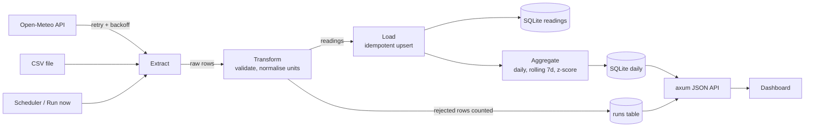

# PulseETL

A compact data pipeline and analytics dashboard in Rust. It extracts weather data from the
free [Open-Meteo](https://open-meteo.com/) API (no key) or a local CSV, validates and aggregates it,
loads it into SQLite, and serves a JSON API plus a responsive dashboard from a single binary.

## Features

- **Extract**: Open-Meteo hourly data for 5 cities (reqwest, retries with exponential backoff) or any CSV file (works offline; sample in `data/`).
- **Transform**: validation and range checks, bad rows rejected and counted, F/K converted to C, daily min/max/avg, rolling 7-day average, z-score anomaly flag (default |z| >= 2.0).
- **Load**: SQLite with idempotent upserts (re-running never duplicates), daily aggregates rebuilt atomically, `runs` table with start/end, rows in/out/rejected and status (`success`, `partial`, `failed`).
- **Scheduler**: tokio interval; `run` ingests on start and then every `--interval-secs`.
- **Dashboard**: KPI tiles, per-city/metric line charts with min-max band and anomaly markers, all-cities sparklines, run history, "Run now", light/dark mode, phone-friendly, accessible (keyboard chart navigation, data table fallback). Assets are embedded in the binary; no CDNs.

## Pipeline



## Run

```
cargo run --release -- ingest --csv data/sample_weather.csv   # offline, one-shot
cargo run --release -- ingest                                 # live Open-Meteo
cargo run --release -- serve --csv data/sample_weather.csv    # dashboard at http://127.0.0.1:8080
cargo run --release -- run --interval-secs 900                # scheduled live ingest + server
```

Global option: `--db <file>` (default `pulse.db`, or env `PULSE_DB`). Other options: `--addr`, `--past-days`, `--z-threshold`.
With `serve`/`run`, the "Run now" button uses the configured source (`--csv` or the API).

## Test

```
cargo test
cargo clippy --all-targets
```

Unit tests cover transforms, aggregation, rolling mean, z-score/anomaly detection, retry and the DB layer;
integration tests load the sample CSV into a temp database and exercise the API.
Regenerate the sample data with `powershell -File data/generate_sample.ps1`.

## API

| Method | Path | Description |
| --- | --- | --- |
| GET | `/api/health` | Status, version, source, last run |
| GET | `/api/metrics` | Totals, cities, metrics, latest daily values, recent anomalies, last run |
| GET | `/api/series?city=&metric=` | Daily series (`temperature`, `humidity`, `wind`) with min/max/avg, rolling7, zscore, anomaly |
| GET | `/api/runs?limit=` | Pipeline run history, newest first |
| POST | `/api/ingest` | Trigger a run now (409 if one is in progress) |

## License

MIT
