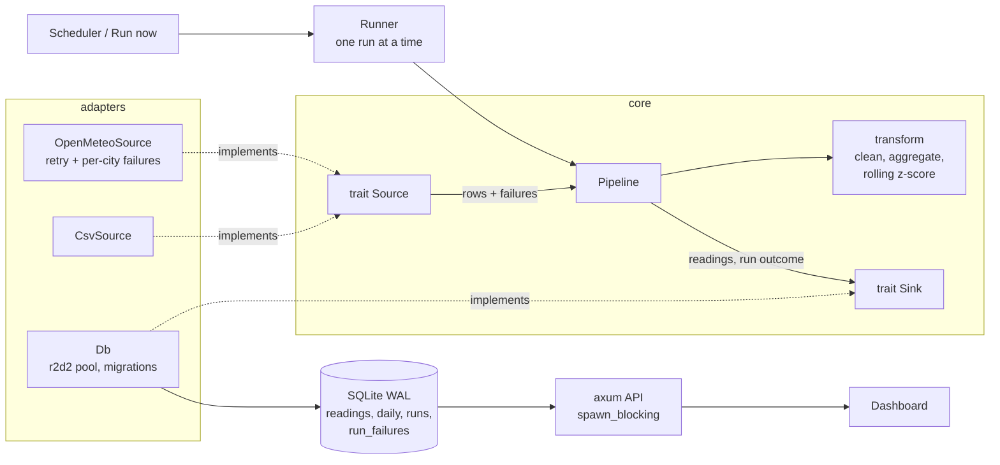

# PulseETL

A compact data pipeline and analytics dashboard in Rust. It extracts weather data from the
free [Open-Meteo](https://open-meteo.com/) API (no key) or a local CSV, validates and aggregates it,
loads it into SQLite, and serves a JSON API plus a responsive dashboard from a single binary.

## Features

- **Extract**: pluggable `Source` trait. Open-Meteo hourly data for 5 cities (reqwest, per-city retries with exponential backoff) or any CSV file (works offline; sample in `data/`).
- **Transform**: validation and range checks, bad rows rejected and counted, F/K converted to C, daily min/max/avg, rolling 7-day average, trailing-window z-score anomaly flag (default |z| >= 2.0 against the previous 7 days).
- **Load**: pluggable `Sink` trait; SQLite with idempotent upserts (re-running never duplicates), daily aggregates rebuilt atomically, versioned migrations.
- **Run tracking**: every execution is a row in `runs` (start/end, rows in/out/rejected, status `success`, `partial`, `failed`) and per-source failures (for example one city that could not be fetched) are stored with the run, not just logged.
- **Scheduler**: tokio interval; `run` ingests on start and then every `--interval-secs`; never overlaps runs; stops cleanly on Ctrl-C / SIGTERM.
- **API**: JSON, paginated series, consistent error bodies, optional bearer token on the one mutating endpoint.
- **Dashboard**: KPI tiles, per-city/metric line charts with min-max band and anomaly markers, all-cities sparklines, run history, "Run now", light/dark mode, phone-friendly, accessible (keyboard chart navigation, data table fallback). Assets are embedded in the binary; no CDNs.

## Architecture



| Module | Responsibility |
| --- | --- |
| `model`, `error` | Shared types; `thiserror` error enums (`anyhow` is used only in `main.rs`) |
| `extract` | `Source` trait and its implementations (`CsvSource`, `OpenMeteoSource`, `MemorySource`) |
| `transform` | Pure functions: validation, unit normalisation, daily aggregates, anomaly detection |
| `pipeline` | `Pipeline` orchestration and the `Sink` trait; knows nothing about SQLite or HTTP |
| `db` | SQLite adapter: connection pool, migrations, upserts, read queries; implements `Sink` |
| `scheduler` | `Runner` (overlap protection, runs on its own task) and the cancellable interval scheduler |
| `server` | axum handlers, auth, pagination, JSON errors; all DB calls via `spawn_blocking` |

Design notes: database work never runs on async worker threads; a run started from the API keeps going if the
client disconnects; runs left `running` by a crash are closed at the next server start. See
[ARCHITECTURE_REVIEW.md](ARCHITECTURE_REVIEW.md) for the review behind these decisions and what was left out on purpose.

### Anomaly detection

Each day's average is compared with the daily averages of the previous `--anomaly-window` calendar days (default 7).
The day itself is not part of its baseline, gross outliers (|z| at least twice the threshold) are excluded from later
baselines so one spike cannot hide the next day, and a per-metric noise floor keeps calm weeks from producing absurd
scores. A day needs at least `--min-baseline` baseline days (default 3), so the first days of a series are never flagged.

## Run

```
cargo run --release -- ingest --csv data/sample_weather.csv   # offline, one-shot
cargo run --release -- ingest                                 # live Open-Meteo
cargo run --release -- serve --csv data/sample_weather.csv    # dashboard at http://127.0.0.1:8080
cargo run --release -- run --interval-secs 900                # scheduled live ingest + server
```

Every option can also be set through a `PULSE_*` environment variable.

| Option | Env | Default | Notes |
| --- | --- | --- | --- |
| `--db` | `PULSE_DB` | `pulse.db` | SQLite file, created and migrated on open |
| `--csv` | `PULSE_CSV` | none | Use a CSV instead of the API |
| `--past-days` | `PULSE_PAST_DAYS` | 14 | 1 to 92 |
| `--z-threshold` | `PULSE_Z_THRESHOLD` | 2.0 | Positive |
| `--anomaly-window` | `PULSE_ANOMALY_WINDOW` | 7 | Trailing baseline, days (2 to 90) |
| `--min-baseline` | `PULSE_MIN_BASELINE` | 3 | Baseline days needed to score a day (2 to 30) |
| `--addr` | `PULSE_ADDR` | `127.0.0.1:8080` | serve / run |
| `--api-token` | `PULSE_API_TOKEN` | unset | serve / run; protects `POST /api/ingest` |
| `--interval-secs` | `PULSE_INTERVAL_SECS` | 3600 | run only |

With `serve`/`run`, the "Run now" button uses the configured source (`--csv` or the API). If `PULSE_API_TOKEN` is set,
the dashboard asks for it once per browser session. Binding to a non-loopback address without a token logs a warning.

## Test

```
cargo test
cargo clippy --all-targets -- -D warnings
```

Unit tests cover transforms, rolling anomaly detection, retry, migrations (including upgrading a v1.0.0 database) and
the DB layer. Integration tests load the sample CSV into a temp database, exercise the API (pagination, validation,
auth, error shapes), run the pipeline against a mock Open-Meteo server with a failing city and against a fake `Sink`,
and check scheduler cancellation, overlap protection and that DB work does not block the runtime.
Regenerate the sample data with `powershell -File data/generate_sample.ps1`.

## API

All errors have the shape `{"error": "message", "code": "bad_request"}`.

| Method | Path | Description |
| --- | --- | --- |
| GET | `/api/health` | Status, version, schema version, source, whether ingest is protected, last run |
| GET | `/api/metrics` | Totals, cities, metrics, latest daily values, recent anomalies, last run |
| GET | `/api/series?city=&metric=&from=&to=&limit=&offset=` | Daily series (`temperature`, `humidity`, `wind`) in ascending day order with min/max/avg, rolling7, zscore, anomaly. `from`/`to` are inclusive `YYYY-MM-DD`; `limit` defaults to 366 (max 1000); response includes `total`, `limit`, `offset` |
| GET | `/api/runs?limit=` | Pipeline run history, newest first, each with its `failures` list |
| POST | `/api/ingest` | Trigger a run now. `409` if one is in progress; `401` without `Authorization: Bearer <token>` when a token is configured |

## License

MIT
